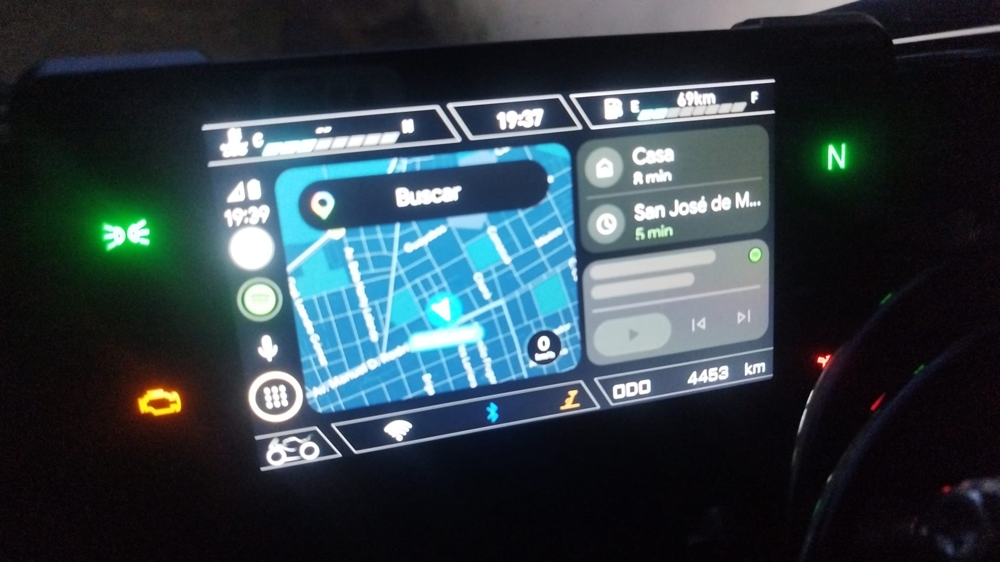
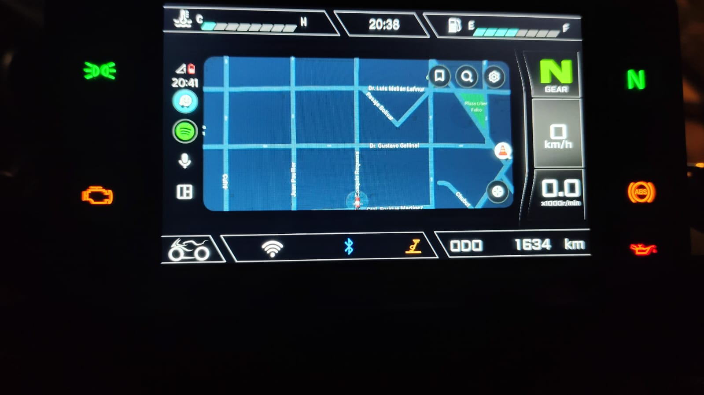

# Open Kove

Android Auto en el tablero de motos Kove con pantalla Carbit/EasyConn (modelo `21318`), para dueños que se quedaron sin una app que funcione. No hace falta root ni PC.





> **Estado:** en prueba, en dos motos: una con un POCO F8 Pro (Android 16, Android Auto 17.9) y una Kove 450R Naked. La moto tiene que estar en **Connection → WiFi Connection** al conectar; si no, conecta pero no muestra imagen. Mirá [el estado técnico](docs/08-KOVE-PROJECTION.md).

## Qué hace

- Muestra Android Auto en la pantalla de la moto, con Maps, Waze y lo demás.
- Conecta sola al abrir la app, después de escanear el QR una vez.
- Rearma la conexión si se corta, hasta que toques **Detener**.
- Trae controles en pantalla para manejar Android Auto. Los botones del manillar no envían nada al teléfono, tampoco con la app china.

## Instalación

Bajá la APK desde [Releases](https://github.com/maagmirror/open-kove/releases) y seguí [la guía desde cero](docs/KOVE-SETUP.md).

Android Auto exige un paso manual: activar su modo desarrollador e iniciar el **servidor de unidad principal**. Hay que volver a iniciarlo cuando reinicies el teléfono.

Si tenés la app EasyRide instalada, cerrala antes: ocupa los mismos puertos.

## Compilar

Hace falta JDK 17 o más nuevo y el Android SDK.

```bash
./gradlew assembleDebug
```

La APK queda en `app/build/outputs/apk/debug/app-debug.apk`. El workflow [`build-apk.yml`](.github/workflows/build-apk.yml) la compila en GitHub y la publica en Releases.

## Documentación

- [Guía de instalación](docs/KOVE-SETUP.md)
- [Cómo funciona la conexión con Kove y qué falta resolver](docs/08-KOVE-PROJECTION.md)
- [Script para probar la conexión desde una PC](scripts/kove_pc_session.py)

## Créditos y licencia

Open Kove es obra de [Maag](https://whoismaag.dev), y es una versión modificada de [OpenCfMoto](https://github.com/zanderp/open-cfmoto), de Alexandru y los colaboradores de OpenCfMoto. Su receptor de Android Auto deriva de [headunit-revived](https://github.com/andreknieriem/headunit-revived).

Se distribuye bajo la [GNU AGPL v3 o posterior](LICENSE). Si distribuís una versión modificada, tenés que ofrecer su código fuente bajo la misma licencia. Autores y componentes de terceros en [NOTICE](NOTICE).

Open Kove es un proyecto independiente y no tiene relación con Kove, Carbit, CFMOTO ni Google. Kove, Android Auto y las demás marcas pertenecen a sus dueños. Usala bajo tu responsabilidad y configurá la ruta antes de salir.
